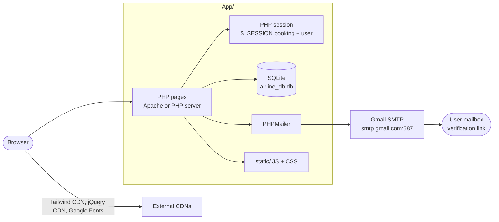
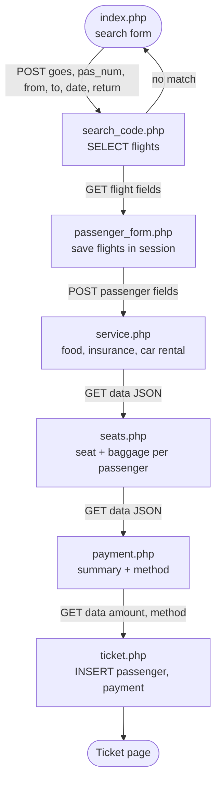
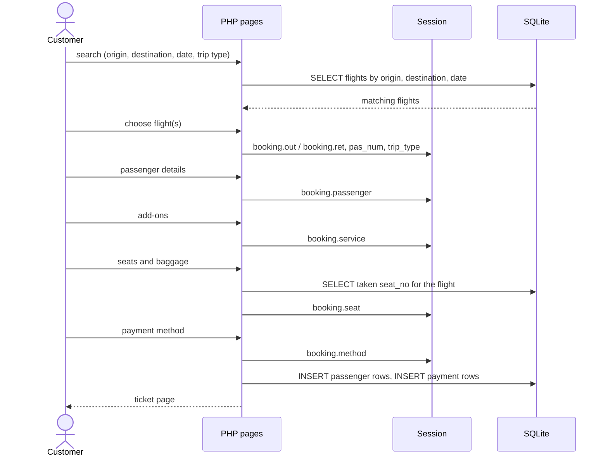
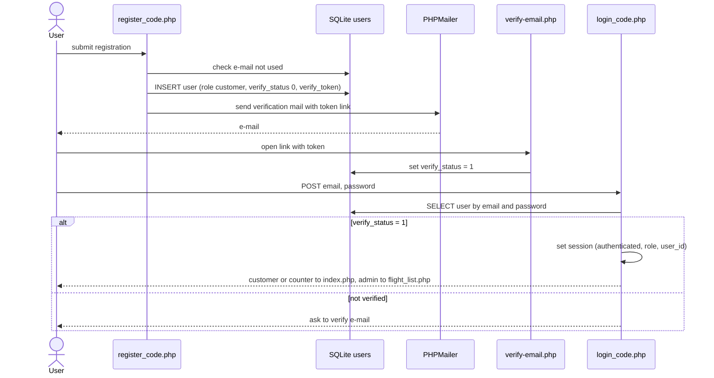
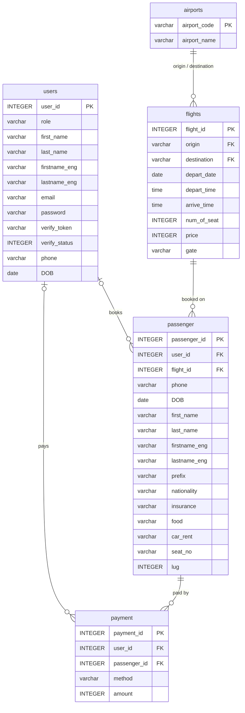

<div align="center">

# Flight Booking System (ISD)

**A web flight-booking platform for customers, counter staff and managers: search, passenger details, add-ons, seats and baggage, payment and e-ticket.**

     

</div>

> **Status: university course project (ISD), working prototype with known security gaps.** The app is plain PHP with server-rendered pages, a SQLite file database and a hard-coded flight dataset from 2023. **It must not be deployed publicly as is**: see [Security review](#security-review). Several statements in earlier README versions did not match the code (MySQL, Bootstrap, "e-ticket by email", manager "delete"); this README follows what the files actually do and marks the differences.

Last updated: 2026-11-03.

---

## Contents

- [Summary in Thai](#summary-in-thai)
- [Problem](#problem)
- [Features by role](#features-by-role)
- [Repository layout](#repository-layout)
- [Tech stack](#tech-stack)
- [System architecture](#system-architecture)
- [Flow 1: Booking journey](#flow-1-booking-journey)
- [Flow 2: Registration and login](#flow-2-registration-and-login)
- [Page and endpoint table](#page-and-endpoint-table)
- [Database schema](#database-schema)
- [Install and run](#install-and-run)
- [Test data](#test-data)
- [Testing](#testing)
- [Security review](#security-review)
- [Known differences from earlier docs](#known-differences-from-earlier-docs)
- [Documents](#documents)

## Summary in Thai

ระบบจองตั๋วเที่ยวบินออนไลน์ พัฒนาด้วย PHP และฐานข้อมูล SQLite (ไฟล์ `App/database/airline_db.db`) แบ่งผู้ใช้เป็น 3 บทบาทในฐานข้อมูล คือ ลูกค้า (customer), พนักงานเคาน์เตอร์ (counter) และผู้จัดการ (admin) ลูกค้าสมัครสมาชิกและยืนยันอีเมลผ่าน PHPMailer ค้นหาเที่ยวบิน (เที่ยวเดียวหรือไป-กลับ) กรอกข้อมูลผู้โดยสาร เลือกบริการเสริม (อาหาร ประกัน เช่ารถ) เลือกที่นั่งและน้ำหนักสัมภาระ ชำระเงิน และได้หน้าตั๋วอิเล็กทรอนิกส์ ผู้จัดการเพิ่ม/แก้ไขเที่ยวบินได้ ข้อควรระวัง: โค้ดนี้เป็นต้นแบบเพื่อการเรียน มีช่องโหว่ด้านความปลอดภัย (SQL injection, รหัสผ่านไม่เข้ารหัส ฯลฯ) จึงไม่ควรนำขึ้นใช้งานจริงโดยไม่แก้ไข ดูหัวข้อ Security review

## Problem

Manual or fragmented ticket booking leads to duplicated work and data-entry errors. The project provides one platform where a customer can search flights, compare prices, enter passengers, add services and choose seats in a single flow, while staff and managers work on the same data.

## Features by role

Roles are stored in `users.role` as `customer`, `counter` and `admin` (the manager role). Code references below are in `App/`.

| Role | What the code supports |
|---|---|
| Customer | Register with e-mail verification, log in/out; search by origin, destination, date, passenger count, one-way or round trip; pick outbound and return flights; enter passenger details; choose food, travel insurance and car rental add-ons; select seats and checked baggage weight; choose a payment method; get a ticket page; bookings are linked to `user_id` when logged in |
| Counter staff | Logs in and lands on the same booking pages (`index.php`) as customers; the README of earlier versions says they book on behalf of customers. I found no separate counter-only pages in the code |
| Manager (`admin`) | Redirected to `flight_list.php` after login; `manager.php` lists flights and supports adding (`INSERT`) and editing (`UPDATE`) flights. I found no flight deletion in the code, although earlier docs mention it |
| Guest | Can search and book without logging in: the ticket step inserts passengers without `user_id` |

## Repository layout

```
flight-booking-ISD/
├── App/
│   ├── index.php                 Search form (one-way / round trip)
│   ├── search_code.php           Search results, selection of outbound/return flights
│   ├── passenger_form.php        Store chosen flights in session; passenger form per seat count
│   ├── service.php               Add-ons: food, insurance, car rental (JS-driven pricing)
│   ├── seats.php                 Seat map and baggage weight per passenger
│   ├── payment.php               Price summary and payment method choice (incl. Thai QR section)
│   ├── ticket.php                Saves passengers and payment, renders the ticket
│   ├── register.php, register_code.php, verify-email.php   Sign-up + PHPMailer verification
│   ├── login.php, login_code.php, logout.php
│   ├── flight_list.php           Authenticated flight / passenger list
│   ├── manager.php               Add / edit flights
│   ├── dbcon.php                 SQLite3 connection to database/airline_db.db
│   ├── includes/                 head.php, navbar.php, footer.php
│   ├── static/                   JS (login, passenger, register validation, search, service), CSS (error, seat)
│   ├── picture/                  Images
│   ├── database/                 airline_db.db (SQLite), airline_db.sqbpro (DB Browser project)
│   ├── composer.json, composer.lock, vendor/   PHPMailer ^6.8 (vendor committed)
│   └── README.txt                Libraries, test accounts, sample searchable flights
├── Project Proposal.pdf          Design document and diagrams
├── Web Technical Report.pdf      Technical report
├── App.zip, main.zip             Archive copies of the project
└── README.md
```

## Tech stack

| Layer | Choice (verified in code) |
|---|---|
| Backend | PHP, procedural pages, PHP sessions |
| Database | SQLite via the PHP `SQLite3` class (`App/dbcon.php`); not MySQL |
| Frontend | HTML, Tailwind CSS (Play CDN with forms/typography plugins), jQuery 3.7.1, vanilla JS in `static/`, Kanit font from Google Fonts |
| Email | PHPMailer `^6.8` through Gmail SMTP (`smtp.gmail.com:587`, TLS) for verification mails |
| Dependency manager | Composer |
| Tools | DB Browser for SQLite project file (`airline_db.sqbpro`) |

<p align="center">
  
</p>

## System architecture



The booking state (chosen flights, passengers, add-ons, seats, payment method) lives only in `$_SESSION['booking']` until `ticket.php` writes it to the database.

## Flow 1: Booking journey





## Flow 2: Registration and login



## Page and endpoint table

There is no REST API. Pages are the interface; data is passed by form posts, query strings and the session.

| Page | Method | Input | Does |
|---|---|---|---|
| `index.php` | GET | none | Search form |
| `search_code.php` | POST `search` | `goes`, `pas_num`, `from`, `to`, `date`, `return` | Queries `flights`; sets a status message when empty |
| `passenger_form.php` | GET | flight id/price/time fields, `pas_num`, `trip_type`, dates | Stores selection in `$_SESSION['booking']`, renders passenger forms |
| `service.php` | POST | passenger fields | Stores passengers; add-on selection UI |
| `seats.php` | GET `data` | JSON of add-ons | Stores add-ons; shows seat map from `passenger.seat_no` per flight |
| `payment.php` | GET `data`, `method` | seat/baggage JSON, payment method | Stores seats/method; shows price breakdown |
| `ticket.php` | GET `data` | JSON with `amount`, `method` | Inserts `passenger` and `payment` rows, shows ticket |
| `register_code.php` | POST `send` | user fields | Creates unverified user, sends verification mail |
| `verify-email.php` | GET | `token` | Marks user verified |
| `login_code.php` / `logout.php` | POST / GET | `email`, `password` | Session login / logout |
| `flight_list.php`, `manager.php` | GET / POST | flight fields | Flight list; add and update flights |

## Database schema

Read from the committed SQLite file (`sqlite3 .schema`). Note the schema has no `bookings` table: a booking is the set of `passenger` rows for a flight plus `payment` rows.



Schema notes: `payment.passenger_id` is declared as a foreign key to `flights(flight_id)` in the DDL, which looks like a mistake (the code treats it as a passenger id); `passenger.first_name` is typed `BLOB`; `users.password` is a plain `varchar`. The committed database has 36 airports, 78 flights, 6 users (2 each of `admin`, `counter`, `customer`), 110 passenger rows and 2 payment rows.

## Install and run

The original instructions assumed XAMPP with MySQL and a `.sql` import. The code uses a SQLite file that is already in the repository, so no import is needed.

Prerequisites: PHP with the SQLite3 extension enabled (the code uses the `SQLite3` class), a web server (Apache from XAMPP/WAMP, or another PHP-capable server) and, only if you need to reinstall PHPMailer, Composer.

1. Clone: `git clone https://github.com/Dxrksvng/flight-booking-ISD.git`
2. Put the `App` folder where your web server serves PHP (for example under XAMPP's `htdocs`). `dbcon.php` opens the database with the relative path `database/airline_db.db`, so the web server's working directory for these pages must be `App/` and the file must be writable by the server user.
3. `vendor/` is committed. To reinstall dependencies (`composer.json` requires `phpmailer/phpmailer ^6.8`), run `composer install` inside `App/`.
4. Configure e-mail: `register_code.php` currently contains a hard-coded Gmail SMTP username and password. Replace them with your own credentials, preferably read from environment variables, before you test registration. Do not commit credentials.
5. Open `http://localhost/<folder>/App/` (the path depends on where you placed the folder).

PHP's built-in server (`php -S`) should also work from inside `App/` (ASSUMPTION: standard PHP behaviour; it is not documented or tested in this repository).

## Test data

- The sample flights in the database are dated in 2023 (for example Bangkok BKK to Hua Hin HHQ on 2023-10-05, HHQ to BKK on 2023-10-06, BKK to Phuket HKT on 2023-10-07, DMK to HKT on 2023-10-18, BKK to Chiang Mai CNX on 2023-10-26). The search uses `depart_date >= date`, so search with a date on or before those days. The full list of origin/destination/date triples is in `App/README.txt`.
- `App/README.txt` lists three test accounts (admin, counter, customer) with a shared password. They are committed in plain text and the e-mails look like real addresses, so I do not repeat them here. Create your own accounts instead. To test registration, use a real mailbox you control, because a verification link is sent.

## Testing

There are no automated tests. Testing in the project was manual. If you extend the app, start with end-to-end tests of the booking flow (search to ticket) and of seat conflicts (two bookings for the same seat).

## Security review

Findings from reading the code. This is an academic prototype; treat the list as a to-fix backlog before any real use. Credentials mentioned here are described, not reproduced.

| # | Finding | Where | Fix |
|---|---|---|---|
| 1 | **SQL injection**: request values are concatenated into SQL strings | `login_code.php`, `register_code.php`, `verify-email.php`, `search_code.php`, `seats.php`, `ticket.php`, `manager.php` | Use prepared statements (`SQLite3::prepare` + `bindValue`) everywhere |
| 2 | **Plain-text passwords**: stored and compared directly | `register_code.php`, `login_code.php`, `users.password` | `password_hash()` / `password_verify()`; force a reset for existing users |
| 3 | **Hard-coded SMTP credentials** for a Gmail account in source (and therefore in git history) | `register_code.php` | Revoke/rotate the password, load from environment, use an app password or a transactional-mail service |
| 4 | **Committed test accounts and personal data**: plain-text credentials in `App/README.txt`; `airline_db.db` contains user and passenger records | `App/README.txt`, `App/database/` | Remove from the repository and history, use synthetic data (Faker) and a fresh seed script |
| 5 | **No role check on staff pages**: `manager.php` and `flight_list.php` only test that a session is authenticated, so a logged-in customer who opens the URL can edit flights | `manager.php`, `flight_list.php` | Check `$_SESSION['role']` server-side on every privileged page |
| 6 | **Trusting client-supplied prices and totals**: flight price travels in query strings, and the payment total and method are passed in the URL to `ticket.php` | `passenger_form.php`, `payment.php`, `ticket.php` | Recompute price server-side from the database; use POST with CSRF tokens; never accept the amount from the client |
| 7 | **Reflected/stored XSS risk**: values from GET/POST/session are echoed into HTML and inline JS without escaping | `seats.php`, `payment.php`, `service.php`, others | `htmlspecialchars()` for HTML, `json_encode()` for JS contexts |
| 8 | **No CSRF protection**, no session regeneration on login, no login rate limit | all forms, `login_code.php` | CSRF tokens, `session_regenerate_id(true)`, throttling |
| 9 | **Weak verification token**: `md5(rand())` | `register_code.php` | `bin2hex(random_bytes(32))` |
| 10 | **No seat-booking transaction**: seats are read from `passenger` and written later, so two users can take the same seat | `seats.php`, `ticket.php` | Wrap check-and-insert in a transaction with a unique constraint on (`flight_id`, `seat_no`) |
| 11 | **Payment is simulated**: payment method is recorded and the amount stored; I found no payment gateway or card validation | `payment.php`, `ticket.php` | Use a real PSP; never handle raw card data yourself (PCI DSS) |
| 12 | **PDPA**: the app collects names, phone numbers, dates of birth, nationality and e-mail without a consent or retention mechanism | forms, DB | Consent notice, retention policy, access controls, encryption at rest |
| 13 | **Third-party scripts** loaded from CDNs without integrity attributes; Tailwind Play CDN is not meant for production | `includes/head.php` | Build CSS locally, add SRI hashes |

## Known differences from earlier docs

| Earlier claim | What the files show |
|---|---|
| MySQL database, import a `.sql` file, `mysqli_connect` | SQLite file `database/airline_db.db`, `SQLite3` class; no `.sql` file in the repository |
| Bootstrap | Tailwind CSS via CDN |
| Ticket is sent by e-mail after payment | PHPMailer is used for the registration verification mail; I found no e-mail sending in `ticket.php` |
| Manager can add, delete or edit flights | `manager.php` has `INSERT` and `UPDATE`; no `DELETE` found |
| Counter staff book for customers | Counter role uses the same booking pages; no dedicated counter flow found |

## Documents

Full design documents and system diagrams are in the repository root: `Project Proposal.pdf` and `Web Technical Report.pdf`.
