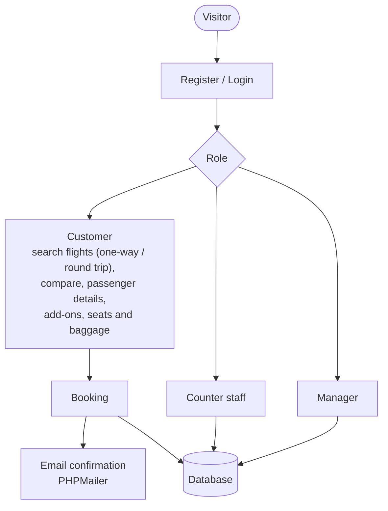

# Flight Booking System (ISD)

**A web flight-booking platform for customers, counter staff and managers.**

   

## Tech stack

  

## Roles and flow

---

โครงงานระบบการจองตั๋วเที่ยวบิน (Flight Booking System)

📝 เกี่ยวกับโครงงาน (About the Project)
ระบบการจองตั๋วเที่ยวบินออนไลน์นี้ถูกพัฒนาขึ้นเพื่อเป็นแพลตฟอร์มที่ช่วยให้ลูกค้าสามารถค้นหาและจองตั๋วเที่ยวบินที่ต้องการได้อย่างสะดวกและรวดเร็ว ระบบถูกออกแบบมาเพื่อแก้ไขปัญหาความซ้ำซ้อนและลดข้อผิดพลาดที่อาจเกิดขึ้นในกระบวนการจองตั๋วแบบดั้งเดิม โดยผู้ใช้สามารถดูรายละเอียดเที่ยวบิน เปรียบเทียบราคา และทำการจองพร้อมบริการเสริมต่างๆ ได้อย่างครบวงจร

✨ คุณสมบัติของระบบ (Features)
ระบบถูกแบ่งการเข้าถึงตามประเภทของผู้ใช้งาน 3 รูปแบบ คือ ลูกค้า, พนักงานเคาน์เตอร์, และผู้จัดการ

🧍 สำหรับลูกค้า (Customer)

การสมัครสมาชิกและเข้าสู่ระบบ: สามารถสมัครสมาชิกใหม่และเข้าสู่ระบบเพื่อจัดการข้อมูลส่วนตัวได้

ค้นหาเที่ยวบิน: ค้นหาเที่ยวบินตามเมืองต้นทาง, ปลายทาง, วันที่เดินทาง (แบบเที่ยวเดียวหรือไป-กลับ)

เลือกเที่ยวบินและดูรายละเอียด: เปรียบเทียบราคาและเลือกรอบเวลาที่ต้องการ

กรอกข้อมูลผู้โดยสาร: กรอกข้อมูลเพื่อทำการจอง

บริการเสริม: เลือกบริการเสริมต่างๆ เช่น อาหาร, ประกันการเดินทาง

จัดการที่นั่งและสัมภาระ: เลือกที่นั่งและจัดการน้ำหนักสัมภาระ

การชำระเงิน: ชำระเงินผ่านช่องทางที่กำหนด

รับตั๋วอิเล็กทรอนิกส์: ระบบจะสร้างและส่งตั๋วให้ทางอีเมลหลังชำระเงินสำเร็จ

🛎️ สำหรับพนักงานเคาน์เตอร์ (Counter Service)

เข้าสู่ระบบ: เข้าสู่ระบบของพนักงาน

จองตั๋วให้ลูกค้า: สามารถทำรายการจองทั้งหมดแทนลูกค้าได้

ดูรายการและรายละเอียดเที่ยวบิน: ตรวจสอบข้อมูลเที่ยวบินในแต่ละวัน

✈️ สำหรับผู้จัดการ (Manager)

เข้าสู่ระบบ: เข้าสู่ระบบสำหรับผู้จัดการ

จัดการเที่ยวบิน: สามารถ เพิ่ม, ลบ, หรือแก้ไขข้อมูลเที่ยวบินในระบบได้

ดูรายการและรายละเอียดเที่ยวบิน: ตรวจสอบข้อมูลและสถานะของทุกเที่ยวบิน

🛠️ เทคโนโลยีที่ใช้ (Technologies Used)
Backend: PHP

Database: MySQL

Frontend: HTML, CSS, JavaScript (with Bootstrap)

Dependency Manager: Composer

Libraries: PHPMailer (สำหรับส่งอีเมลยืนยัน)

🚀 การติดตั้งและใช้งาน (Installation and Setup)
สิ่งที่ต้องมี (Prerequisites)

Web Server (เช่น XAMPP, WAMP) ที่มี PHP และ MySQL

Composer

ขั้นตอนการติดตั้ง (Installation Steps)

Clone the repository:

git clone https://github.com/Dxrksvng/flight-booking-ISD.git

ย้ายโปรเจกต์:
นำโฟลเดอร์ flight-booking-ISD ไปไว้ใน htdocs ของ XAMPP

ตั้งค่าฐานข้อมูล:

เปิด phpMyAdmin และสร้างฐานข้อมูลใหม่ (เช่น flight_booking_db)

Import ไฟล์ .sql ที่อยู่ในโฟลเดอร์ /database เข้าไปในฐานข้อมูลที่สร้างขึ้น

แก้ไขไฟล์เชื่อมต่อฐานข้อมูล:

เปิดไฟล์ App/dbcon.php

แก้ไขข้อมูลการเชื่อมต่อให้ตรงกับฐานข้อมูลของคุณ

$con = mysqli_connect("localhost", "root", "", "flight_booking_db");

ติดตั้ง Dependencies:

เปิด Command Line หรือ Terminal แล้วเข้าไปที่ไดเรกทอรี App

รันคำสั่ง:

composer install

เปิดใช้งาน:

เปิดใช้งาน Apache และ MySQL ใน XAMPP

เข้าถึงโปรเจกต์ผ่านเบราว์เซอร์: http://localhost/flight-booking-ISD/App/

👨‍💻 การใช้งาน (Usage)
บัญชีผู้ใช้สำหรับทดสอบ (Test Accounts)

หมายเหตุ: หากต้องการทดสอบฟังก์ชัน สมัครสมาชิก กรุณาใช้อีเมลจริง เนื่องจากระบบจะมีการส่งอีเมลยืนยันผ่าน PHPMailer

ตัวอย่างเที่ยวบินที่สามารถค้นหาได้ (Searchable Flights)

ต้นทาง

ปลายทาง

วันที่ (ปี-เดือน-วัน)

BKK

HHQ

2023-10-05

HHQ

BKK

2023-10-06

ดูเอกสารและแผนภาพการออกแบบระบบฉบับเต็มได้ที่ไฟล์ Project Proposal.pdf
